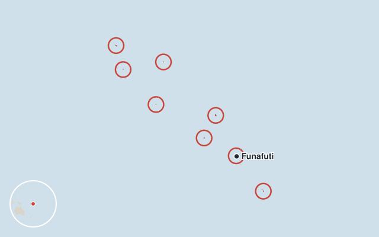

---
id    = "27d95a47-a2cd-5a24-8e42-06c7b5e55d2f"
model = "Basic"
tags  = ["oceania", "sovereign_state", "country"]
---

## Front

<b>Funafuti</b> is the capital of which country or territory?

## Back

<b>Tuvalu</b>

## Extra

About 10,600 people (2022 census) Official languages: English and Tuvaluan

The name means 'eight standing together' in Tuvaluan. It became fully independent on 1 October 1978, as a sovereign state within the Commonwealth.

<a href="https://en.wikipedia.org/wiki/Tuvalu">Tuvalu on Wikipedia</a> <a href="https://en.wikipedia.org/wiki/Funafuti">Funafuti on Wikipedia</a>
