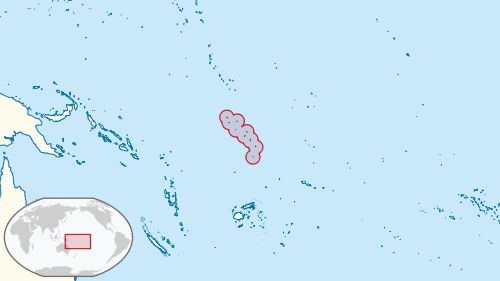
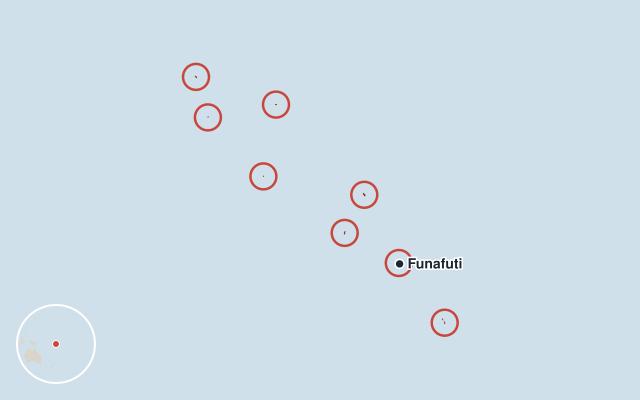

---
id    = "ac51bf42-2c7c-5703-8a18-59644602e879"
model = "Basic"
tags  = ["oceania", "sovereign_state", "map"]
---

## Front

What is highlighted on this map?

## Back

<b>Tuvalu</b>

## Extra

<a href="https://en.wikipedia.org/wiki/Tuvalu">Tuvalu on Wikipedia</a>
