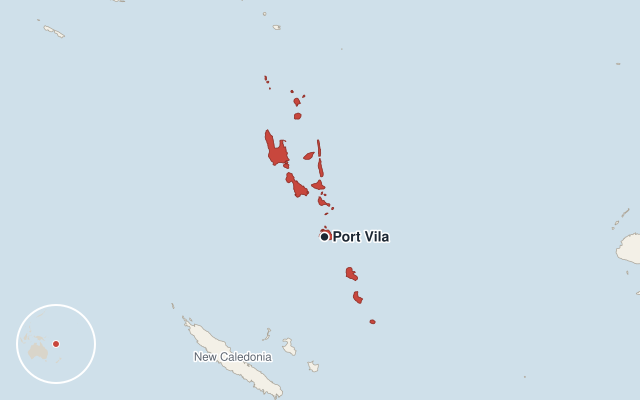
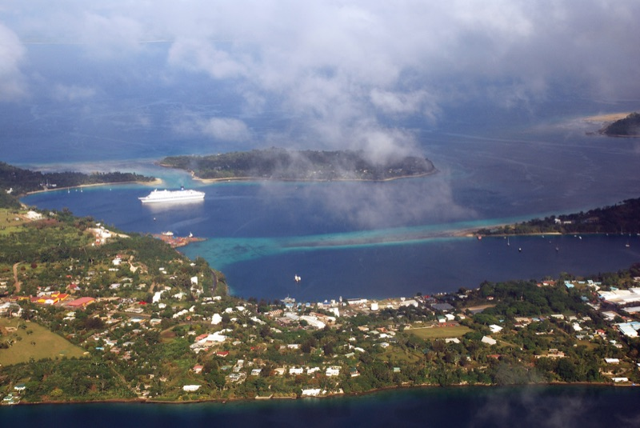

---
id    = "b9b9d8d5-71fc-5339-bd2c-7dbe4adeb7e6"
model = "Basic"
tags  = ["oceania", "sovereign_state", "capital"]
---

## Front

What is the capital of <b>Vanuatu</b>?

## Back

<b>Port Vila</b>

## Extra

<i>Photo: Phillip Capper from Wellington, New Zealand, CC BY 2.0, via Wikimedia Commons</i>

About 49,000 people (2020 census), 16.3% of the country On the west coast of Efate, the country's commercial centre

Locally it is simply "Vila", a variant of Efil and Ifira, the names of the area in two local languages. Melanesian people have occupied the area for thousands of years.

<a href="https://en.wikipedia.org/wiki/Port_Vila">Port Vila on Wikipedia</a> <a href="https://en.wikipedia.org/wiki/Vanuatu">Vanuatu on Wikipedia</a>
