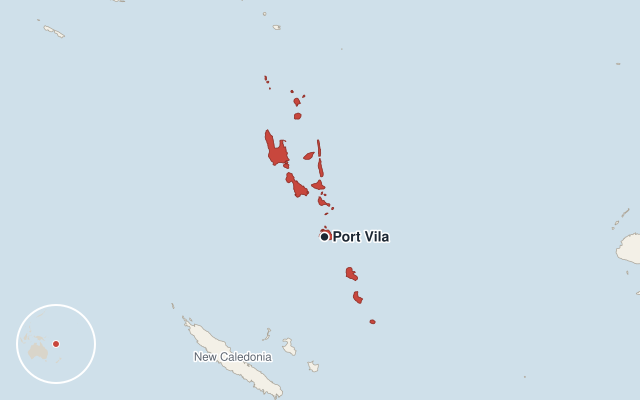

---
id    = "2af827b5-9a13-5be7-973d-cf14daf5325a"
model = "Basic"
tags  = ["oceania", "sovereign_state", "country"]
---

## Front

<b>Port Vila</b> is the capital of which country or territory?

## Back

<b>Vanuatu</b>

## Extra

<i>Photo: Unknown author, Public domain, via Wikimedia Commons</i>

About 300,000 people (2020) in 12,190 km² Official languages: Bislama, English and French

The name joins vanua, 'land' or 'home', and tu, 'to stand' or 'remain'. France and the United Kingdom agreed in 1906 to manage it jointly as the New Hebrides, an Anglo-French condominium.

<a href="https://en.wikipedia.org/wiki/Vanuatu">Vanuatu on Wikipedia</a> <a href="https://en.wikipedia.org/wiki/Port_Vila">Port Vila on Wikipedia</a>
