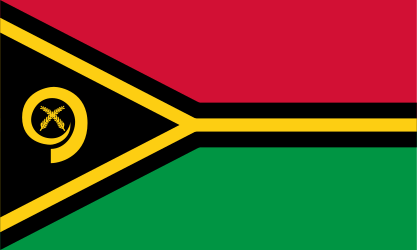
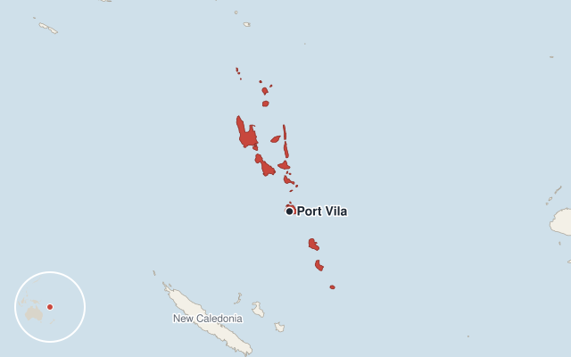

---
id    = "55ad2fe6-acf6-5533-9a20-51e6e668f149"
model = "Basic"
tags  = ["oceania", "sovereign_state", "flag"]
---

## Front

Whose flag is this?

## Back

<b>Vanuatu</b>

## Extra

Adopted on 18 February 1980, before independence on 30 July 1980

The yellow Y-shape stands for the shape of the islands on the map. The black emblem is a boar's tusk, a symbol of customs and tradition, with two namele leaves as a token of peace.

<a href="https://en.wikipedia.org/wiki/Flag_of_Vanuatu">Flag of Vanuatu on Wikipedia</a> <a href="https://en.wikipedia.org/wiki/Vanuatu">Vanuatu on Wikipedia</a>
