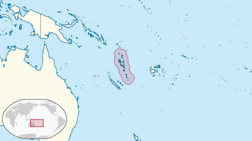
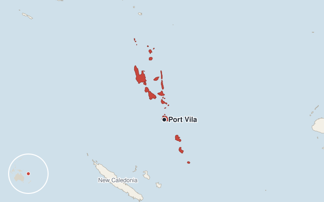

---
id    = "cd6f5afa-a124-5d1c-b919-14ab3ad7b33d"
model = "Basic"
tags  = ["oceania", "sovereign_state", "map"]
---

## Front

What is highlighted on this map?

## Back

<b>Vanuatu</b>

## Extra

<i>Photo: Unknown author, Public domain, via Wikimedia Commons</i>

An archipelago of volcanic origin 1,750 km east of northern Australia

The largest island is Espíritu Santo. The archipelago lies 540 km northeast of New Caledonia and west of Fiji.

<a href="https://en.wikipedia.org/wiki/Vanuatu">Vanuatu on Wikipedia</a>
