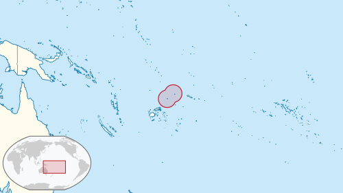

---
id    = "e35b162e-e819-562e-a4aa-e30325c63539"
model = "Basic"
tags  = ["oceania", "map"]
---

## Front

What is highlighted on this map?

## Back

<b>Wallis and Futuna</b>

## Extra

About 142 km² of land Three main volcanic islands plus tiny islets

Two island groups lie about 260 km apart: the Wallis Islands in the northeast and the Hoorn or Futuna Islands in the southwest.

Overseas territory of France.

<a href="https://en.wikipedia.org/wiki/Wallis_and_Futuna">Wallis and Futuna on Wikipedia</a>
