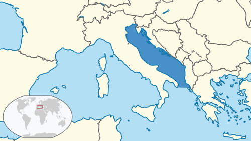

---
id    = "3e2127df-955b-5118-8b4c-7f8a69b796a1"
model = "Basic"
tags  = ["oceans-and-seas", "map"]
---

## Front

What is highlighted on this map?

## Back

<b>Adriatic Sea</b>

## Extra

About 138,600 km², up to 1,233 m deep Coasts on Albania, Bosnia and Herzegovina, Croatia, Italy, Montenegro and Slovenia

Less salty than the Mediterranean it feeds into, because it collects a third of the fresh water flowing into the Mediterranean.

<a href="https://en.wikipedia.org/wiki/Adriatic_Sea">Adriatic Sea on Wikipedia</a>
