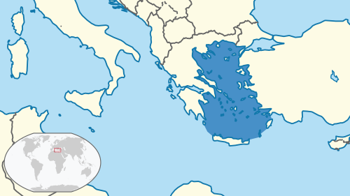

---
id    = "57581405-0edd-5c9d-b900-a54bcffd4697"
model = "Basic"
tags  = ["oceans-and-seas", "map"]
---

## Front

What is highlighted on this map?

## Back

<b>Aegean Sea</b>

## Extra

About 215,000 km², up to 2,639 m deep Dotted with islands, including Crete and Rhodes

An arm of the Mediterranean between Greece and Turkey. To the north the Dardanelles lead to the Marmara Sea, and the Bosphorus beyond it to the Black Sea.

<a href="https://en.wikipedia.org/wiki/Aegean_Sea">Aegean Sea on Wikipedia</a>
