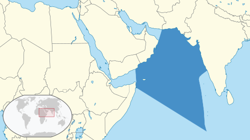

---
id    = "ec35fb50-343a-5c5e-92d6-7e0157ad158f"
model = "Basic"
tags  = ["oceans-and-seas", "map"]
---

## Front

What is highlighted on this map?

## Back

<b>Arabian Sea</b>

## Extra

About 3.86 million km², up to 5,395 m deep Borders Pakistan, India, Iran and the Arabian Peninsula

Its two arms are the Gulf of Aden, which reaches the Red Sea through the Bab-el-Mandeb, and the Gulf of Oman, which reaches the Persian Gulf.

<a href="https://en.wikipedia.org/wiki/Arabian_Sea">Arabian Sea on Wikipedia</a>
