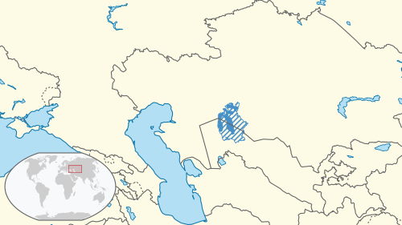

---
id    = "8efd8e95-93cb-5194-ac81-0502d124b66a"
model = "Basic"
tags  = ["oceans-and-seas", "map"]
---

## Front

What is highlighted on this map?

## Back

<b>Aral Sea</b>

## Extra

<a href="https://en.wikipedia.org/wiki/Aral_Sea">Aral Sea on Wikipedia</a>
