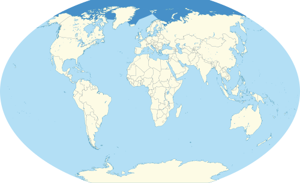

---
id    = "51555309-df50-5651-8549-755463cf7af0"
model = "Basic"
tags  = ["oceans-and-seas", "map"]
---

## Front

What is highlighted on this map?

## Back

<b>Arctic Ocean</b>

## Extra

<a href="https://en.wikipedia.org/wiki/Arctic_Ocean">Arctic Ocean on Wikipedia</a>
