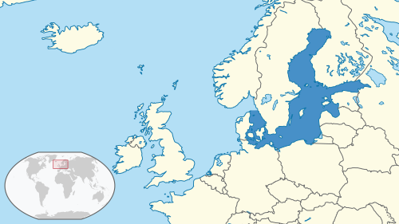

---
id    = "f1315879-64ac-5e24-8293-67e36c683660"
model = "Basic"
tags  = ["oceans-and-seas", "map"]
---

## Front

What is highlighted on this map?

## Back

<b>Baltic Sea</b>

## Extra

About 377,000 km², 55 m deep on average Enclosed by Denmark, Estonia, Finland, Germany, Latvia, Lithuania, Poland, Russia and Sweden

The world's largest brackish water basin. Little water is exchanged with the Atlantic, and it drains through the Danish Straits into the Kattegat.

<a href="https://en.wikipedia.org/wiki/Baltic_Sea">Baltic Sea on Wikipedia</a>
