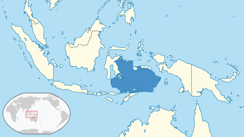

---
id    = "9a8d76c9-2e47-5588-9880-4274a96e6bf5"
model = "Basic"
tags  = ["oceans-and-seas", "map"]
---

## Front

What is highlighted on this map?

## Back

<b>Banda Sea</b>

## Extra

About 470,000 km², about 1,000 km east to west Deepest point, Weber Deep, more than 7.2 km down

One of four seas around the Maluku Islands of Indonesia. Its Weber Deep is the world's deepest forearc basin.

<a href="https://en.wikipedia.org/wiki/Banda_Sea">Banda Sea on Wikipedia</a>
