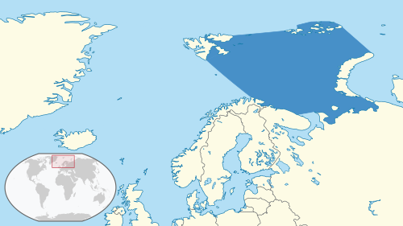

---
id    = "6b82a570-cba6-54d3-b0c0-00f164923022"
model = "Basic"
tags  = ["oceans-and-seas", "map"]
---

## Front

What is highlighted on this map?

## Back

<b>Barents Sea</b>

## Extra

<a href="https://en.wikipedia.org/wiki/Barents_Sea">Barents Sea on Wikipedia</a>
