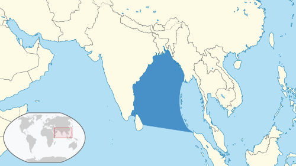

---
id    = "851c9ad7-337c-5e04-bebf-c06014e1d6bf"
model = "Basic"
tags  = ["oceans-and-seas", "map"]
---

## Front

What is highlighted on this map?

## Back

<b>Bay of Bengal</b>

## Extra

About 2.6 million km², between India and the Indochinese peninsula The Ganges, Brahmaputra and Irrawaddy flow into it

Its coast includes the Sundarbans, the largest mangrove forest in the world, and Cox's Bazar, one of the world's longest natural beaches.

<a href="https://en.wikipedia.org/wiki/Bay_of_Bengal">Bay of Bengal on Wikipedia</a>
