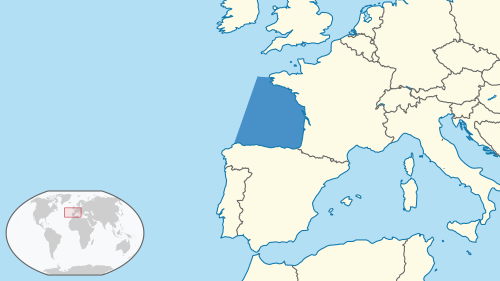

---
id    = "c6f8b301-9ab1-5bad-8e92-bc85af9d9146"
model = "Basic"
tags  = ["oceans-and-seas", "map"]
---

## Front

What is highlighted on this map?

## Back

<b>Bay of Biscay</b>

## Extra

<a href="https://en.wikipedia.org/wiki/Bay_of_Biscay">Bay of Biscay on Wikipedia</a>
