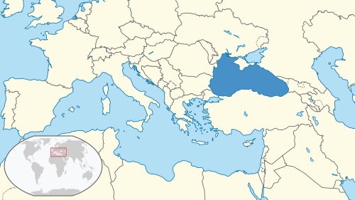

---
id    = "a3e66167-ea78-535a-9c48-378f1456ed63"
model = "Basic"
tags  = ["oceans-and-seas", "map"]
---

## Front

What is highlighted on this map?

## Back

<b>Black Sea</b>

## Extra

About 436,400 km², up to 2,212 m deep Bordered by Bulgaria, Georgia, Romania, Russia, Turkey and Ukraine

A deep layer of its water does not drain or mix, so it is anoxic. That layer has preserved ancient shipwrecks.

<a href="https://en.wikipedia.org/wiki/Black_Sea">Black Sea on Wikipedia</a>
