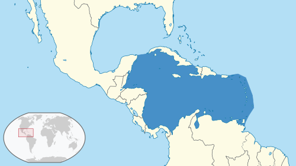

---
id    = "af78c726-09d4-5571-bcce-05330f5b59b3"
model = "Basic"
tags  = ["oceans-and-seas", "map"]
---

## Front

What is highlighted on this map?

## Back

<b>Caribbean Sea</b>

## Extra

About 2.75 million km², up to 7,686 m deep in the Cayman Trough Borders 12 continental countries

Home to the world's second-largest barrier reef, the Mesoamerican Barrier Reef, which runs 1,000 km along the coasts of Mexico, Belize, Guatemala and Honduras.

<a href="https://en.wikipedia.org/wiki/Caribbean_Sea">Caribbean Sea on Wikipedia</a>
