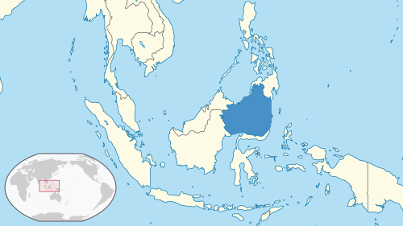

---
id    = "0195a87a-0820-5b8c-9e51-642cc508e2f0"
model = "Basic"
tags  = ["oceans-and-seas", "map"]
---

## Front

What is highlighted on this map?

## Back

<b>Celebes Sea</b>

## Extra

<a href="https://en.wikipedia.org/wiki/Celebes_Sea">Celebes Sea on Wikipedia</a>
