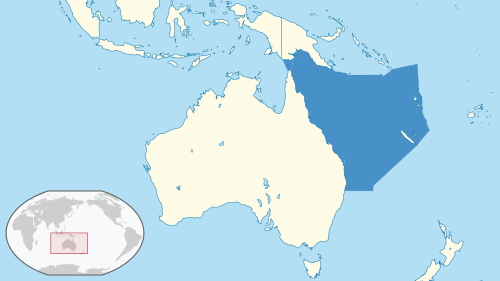

---
id    = "aaf25dd5-5dce-5696-8aa5-cfa927dab60f"
model = "Basic"
tags  = ["oceans-and-seas", "map"]
---

## Front

What is highlighted on this map?

## Back

<b>Coral Sea</b>

## Extra

About 4.79 million km², extending 2,000 km down Australia's northeast coast Between Queensland, Vanuatu and New Caledonia

Contains the Great Barrier Reef, the world's largest reef system. It was also the site of the Battle of the Coral Sea in World War II.

<a href="https://en.wikipedia.org/wiki/Coral_Sea">Coral Sea on Wikipedia</a>
