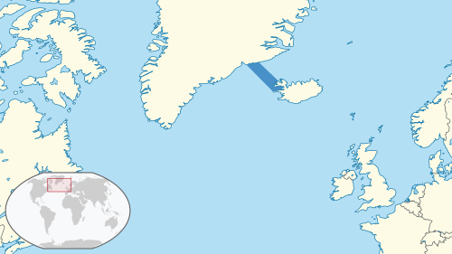

---
id    = "4025698e-f871-5abe-a932-eb92fd9b0677"
model = "Basic"
tags  = ["oceans-and-seas", "map"]
---

## Front

What is highlighted on this map?

## Back

<b>Denmark Strait</b>

## Extra

480 km long, 290 km wide at its narrowest Separates Greenland from Iceland

Connects the Greenland Sea to the Irminger Sea. The world's largest known underwater waterfall, the Denmark Strait cataract, flows down its western side.

<a href="https://en.wikipedia.org/wiki/Denmark_Strait">Denmark Strait on Wikipedia</a>
