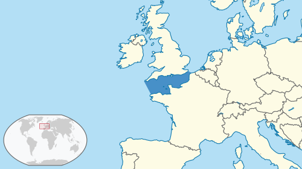

---
id    = "e8b2a37d-39a8-571e-b6ad-26ad9c1d1103"
model = "Basic"
tags  = ["oceans-and-seas", "map"]
---

## Front

What is highlighted on this map?

## Back

<b>English Channel</b>

## Extra

About 560 km long, 75,000 km2 34 km wide at its narrowest, in the Strait of Dover

It separates southern England from northern France, and is the smallest of the shallow seas around the continental shelf of Europe.

<a href="https://en.wikipedia.org/wiki/English_Channel">English Channel on Wikipedia</a>
