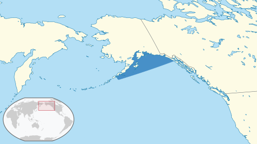

---
id    = "041ab9e6-54df-5c31-94fc-23f9105e35f2"
model = "Basic"
tags  = ["oceans-and-seas", "map"]
---

## Front

What is highlighted on this map?

## Back

<b>Gulf of Alaska</b>

## Extra

<a href="https://en.wikipedia.org/wiki/Gulf_of_Alaska">Gulf of Alaska on Wikipedia</a>
