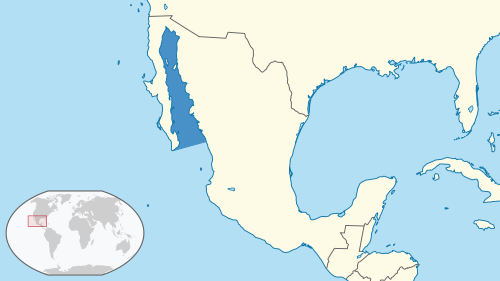

---
id    = "9f994556-fefe-52ae-96bc-e84796da9dfe"
model = "Basic"
tags  = ["oceans-and-seas", "map"]
---

## Front

What is highlighted on this map?

## Back

<b>Gulf of California</b>

## Extra

About 160,000 km2, with about 4,000 km of coastline Maximum depths exceed 3,000 m

It separates the Baja California peninsula from the Mexican mainland and is also called the Sea of Cortez.

Also known as the Sea of Cortez.

<a href="https://en.wikipedia.org/wiki/Gulf_of_California">Gulf of California on Wikipedia</a>
