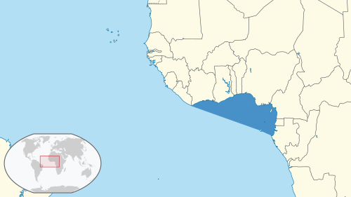

---
id    = "54f4286b-4a80-566f-9444-75c088744376"
model = "Basic"
tags  = ["oceans-and-seas", "map"]
---

## Front

What is highlighted on this map?

## Back

<b>Gulf of Guinea</b>

## Extra

<a href="https://en.wikipedia.org/wiki/Gulf_of_Guinea">Gulf of Guinea on Wikipedia</a>
