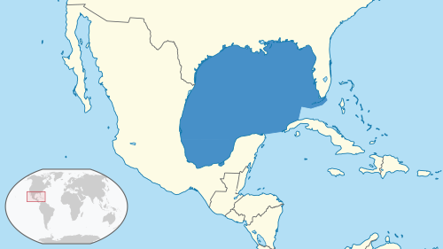

---
id    = "bb13a90b-c3ca-5ac0-86eb-d587bc5b4a02"
model = "Basic"
tags  = ["oceans-and-seas", "map"]
---

## Front

What is highlighted on this map?

## Back

<b>Gulf of Mexico</b>

## Extra

About 1.6 million km2, about 1,500 km wide Contains about 2.4 million cubic km of water

Mostly surrounded by North America, it is one of the largest offshore petroleum regions in the world.

<a href="https://en.wikipedia.org/wiki/Gulf_of_Mexico">Gulf of Mexico on Wikipedia</a>
