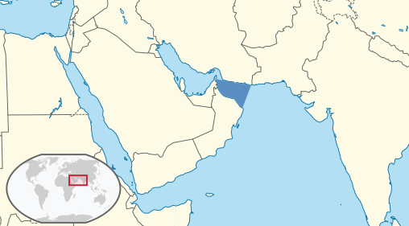

---
id    = "88803fc5-65b6-514b-9bfa-588e10e9440d"
model = "Basic"
tags  = ["oceans-and-seas", "map"]
---

## Front

What is highlighted on this map?

## Back

<b>Gulf of Oman</b>

## Extra

Connects the Arabian Sea with the Strait of Hormuz Borders Iran, Pakistan, Oman and the United Arab Emirates

It holds one of the world's largest marine dead zones, confirmed in 2018, where there is little or no oxygen.

Also known as Gulf of Makran.

<a href="https://en.wikipedia.org/wiki/Gulf_of_Oman">Gulf of Oman on Wikipedia</a>
