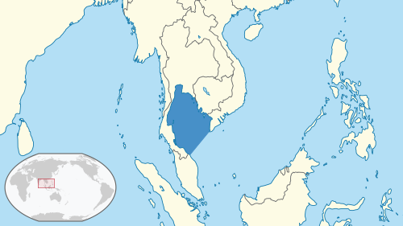

---
id    = "7b91b646-c2e5-509a-b03a-465a2917c0e7"
model = "Basic"
tags  = ["oceans-and-seas", "map"]
---

## Front

What is highlighted on this map?

## Back

<b>Gulf of Thailand</b>

## Extra

About 320,000 km2, around 800 km long Up to 560 km wide

Once called the Gulf of Siam, it was widely known by that name until the country renamed itself Thailand in 1939.

Also known as the Gulf of Siam.

<a href="https://en.wikipedia.org/wiki/Gulf_of_Thailand">Gulf of Thailand on Wikipedia</a>
