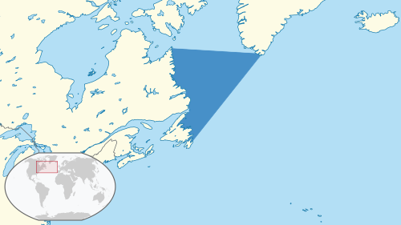

---
id    = "7d99122c-c2e2-56b4-8d1e-8f4d62a420b8"
model = "Basic"
tags  = ["oceans-and-seas", "map"]
---

## Front

What is highlighted on this map?

## Back

<b>Labrador Sea</b>

## Extra

<a href="https://en.wikipedia.org/wiki/Labrador_Sea">Labrador Sea on Wikipedia</a>
