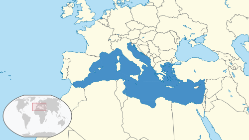

---
id    = "d4d882ee-2779-5c07-bc16-a74de8e1a2b1"
model = "Basic"
tags  = ["oceans-and-seas", "map"]
---

## Front

What is highlighted on this map?

## Back

<b>Mediterranean Sea</b>

## Extra

About 2,500,000 km2, 0.7% of the global ocean Deepest point 5,109 m, in the Calypso Deep

Cut off from the Atlantic about 5.9 million years ago, it partly or completely dried out over some 600,000 years before refilling.

<a href="https://en.wikipedia.org/wiki/Mediterranean_Sea">Mediterranean Sea on Wikipedia</a>
