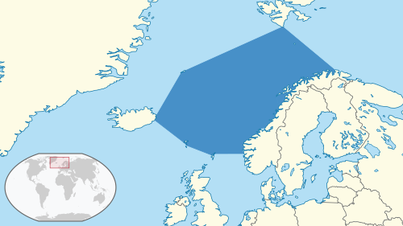

---
id    = "bbf70790-d402-5757-b14a-c0e344b02449"
model = "Basic"
tags  = ["oceans-and-seas", "map"]
---

## Front

What is highlighted on this map?

## Back

<b>Norwegian Sea</b>

## Extra

About 1,383,000 km2 Bottom lies about 2 km deep on average

Unlike many seas, most of its bottom is not continental shelf, so it is deep; oil and gas are explored where depths reach about 1 km.

<a href="https://en.wikipedia.org/wiki/Norwegian_Sea">Norwegian Sea on Wikipedia</a>
