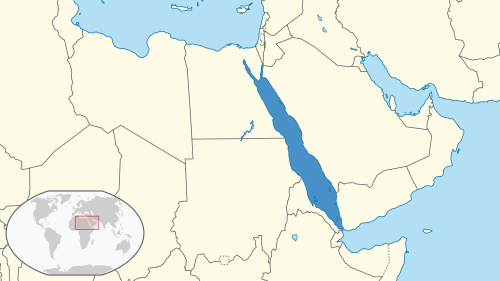

---
id    = "3630db02-8218-5389-8b16-1e8155b1b5a9"
model = "Basic"
tags  = ["oceans-and-seas", "map"]
---

## Front

What is highlighted on this map?

## Back

<b>Red Sea</b>

## Extra

About 438,000 km2, 2,250 km long Maximum depth 2,730 m, in the Suakin Trough

The world's northernmost tropical sea, lying between the Arabian Peninsula and Africa.

<a href="https://en.wikipedia.org/wiki/Red_Sea">Red Sea on Wikipedia</a>
