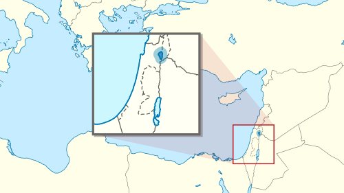

---
id    = "a7e45184-4080-5111-84f3-e5d7295a41a6"
model = "Basic"
tags  = ["oceans-and-seas", "map"]
---

## Front

What is highlighted on this map?

## Back

<b>Sea of Galilee</b>

## Extra

About 167 km2, 21 km long and 13 km wide Maximum depth about 43 m

The lowest freshwater lake on Earth, at 209 to 215 m below sea level.

<a href="https://en.wikipedia.org/wiki/Sea_of_Galilee">Sea of Galilee on Wikipedia</a>
