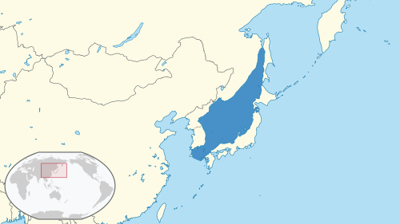

---
id    = "ccb6ab2f-de69-5a44-8fee-1cd4dfaa41bb"
model = "Basic"
tags  = ["oceans-and-seas", "map"]
---

## Front

What is highlighted on this map?

## Back

<b>Sea of Japan</b>

## Extra

A naming dispute exists between the sea's bordering countries, with South Korea notably supporting the name East Sea.

<a href="https://en.wikipedia.org/wiki/Sea_of_Japan">Sea of Japan on Wikipedia</a>
