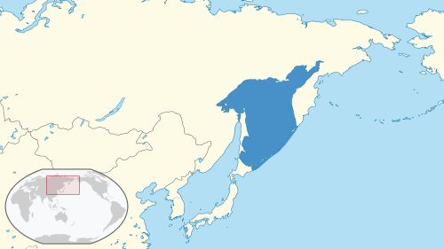

---
id    = "aa59f6fb-1d1e-5418-bd8d-c6a88118f92e"
model = "Basic"
tags  = ["oceans-and-seas", "map"]
---

## Front

What is highlighted on this map?

## Back

<b>Sea of Okhotsk</b>

## Extra

<a href="https://en.wikipedia.org/wiki/Sea_of_Okhotsk">Sea of Okhotsk on Wikipedia</a>
