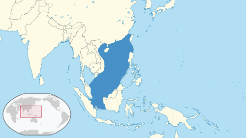

---
id    = "d9ccb83a-11d9-5bcb-8767-6714129e55b8"
model = "Basic"
tags  = ["oceans-and-seas", "map"]
---

## Front

What is highlighted on this map?

## Back

<b>South China Sea</b>

## Extra

<a href="https://en.wikipedia.org/wiki/South_China_Sea">South China Sea on Wikipedia</a>
