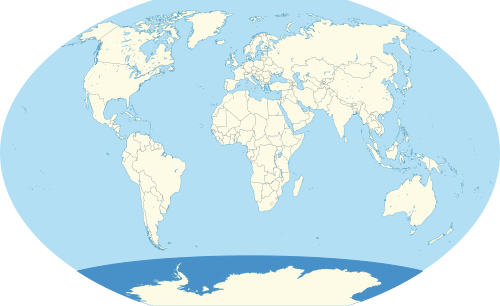

---
id    = "25f02901-9fb1-5199-abd6-d895a015a328"
model = "Basic"
tags  = ["oceans-and-seas", "map"]
---

## Front

What is highlighted on this map?

## Back

<b>Southern Ocean</b>

## Extra

About 21,960,000 km2, south of 60° S Deepest point 7,434 m, surveyed in 2019

It encircles Antarctica and is the second-smallest of the five oceans. The International Hydrographic Organization only settled its definition in 2000.

<a href="https://en.wikipedia.org/wiki/Southern_Ocean">Southern Ocean on Wikipedia</a>
