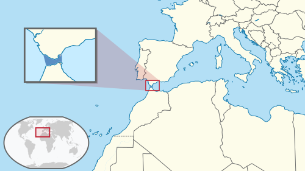

---
id    = "52ac8ced-18f9-57f6-b0d8-28f184dbb78b"
model = "Basic"
tags  = ["oceans-and-seas", "map"]
---

## Front

What is highlighted on this map?

## Back

<b>Strait of Gibraltar</b>

## Extra

<a href="https://en.wikipedia.org/wiki/Strait_of_Gibraltar">Strait of Gibraltar on Wikipedia</a>
