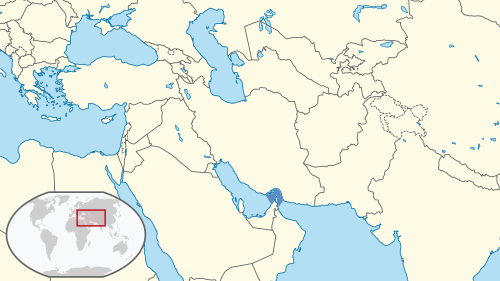

---
id    = "4fdde0d5-89c0-58eb-a811-449775844e4f"
model = "Basic"
tags  = ["oceans-and-seas", "map"]
---

## Front

What is highlighted on this map?

## Back

<b>Strait of Hormuz</b>

## Extra

<a href="https://en.wikipedia.org/wiki/Strait_of_Hormuz">Strait of Hormuz on Wikipedia</a>
