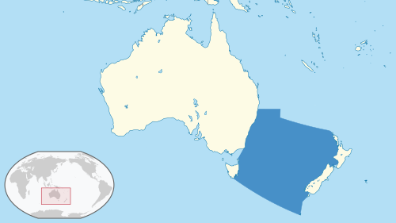

---
id    = "aa929b76-df48-5347-a4d7-1ec3a2c257ea"
model = "Basic"
tags  = ["oceans-and-seas", "map"]
---

## Front

What is highlighted on this map?

## Back

<b>Tasman Sea</b>

## Extra

About 2,300,000 km² between Australia and New Zealand Up to 5,943 m deep

Named after Abel Janszoon Tasman, the Dutch explorer who in 1642 was the first known European to cross it. Its Māori name, Te Moana-a-Rehua, means 'the sea of Rehua'.

<a href="https://en.wikipedia.org/wiki/Tasman_Sea">Tasman Sea on Wikipedia</a>
