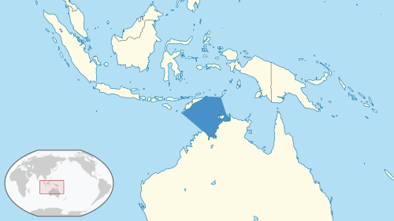

---
id    = "7a048bda-189c-511e-a8fc-92019c5f9a90"
model = "Basic"
tags  = ["oceans-and-seas", "map"]
---

## Front

What is highlighted on this map?

## Back

<b>Timor Sea</b>

## Extra

<a href="https://en.wikipedia.org/wiki/Timor_Sea">Timor Sea on Wikipedia</a>
