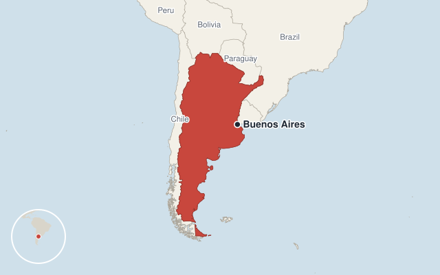

---
id    = "a29ba87f-5be8-55da-aadf-4d124f03d95d"
model = "Basic"
tags  = ["south_america", "sovereign_state", "capital"]
---

## Front

What is the capital of <b>Argentina</b>?

## Back

<b>Buenos Aires</b>

## Extra

<a href="https://en.wikipedia.org/wiki/Buenos_Aires">Buenos Aires on Wikipedia</a> <a href="https://en.wikipedia.org/wiki/Argentina">Argentina on Wikipedia</a>
