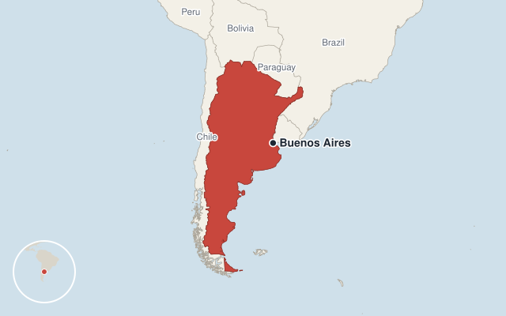

---
id    = "5707ac05-df36-5887-a5f4-a1910b5230d2"
model = "Basic"
tags  = ["south_america", "sovereign_state", "country"]
---

## Front

<b>Buenos Aires</b> is the capital of which country or territory?

## Back

<b>Argentina</b>

## Extra

About 47.3 million people (2022) 2,780,085 km², the second-largest country in South America

The name comes from the Latin argentum, silver. Early explorers around the Río de la Plata learned of silver in the region.

<a href="https://en.wikipedia.org/wiki/Argentina">Argentina on Wikipedia</a> <a href="https://en.wikipedia.org/wiki/Buenos_Aires">Buenos Aires on Wikipedia</a>
