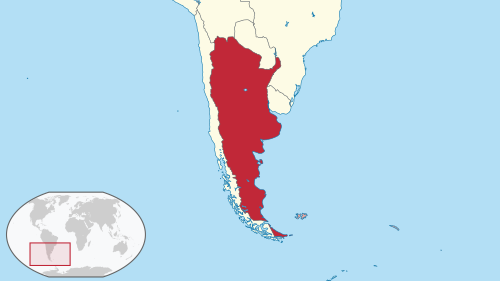
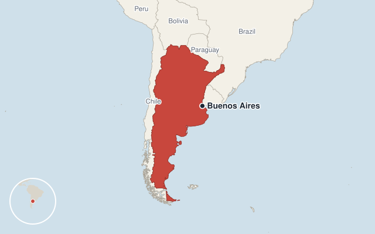

---
id    = "16b66e8b-89f2-5979-bbfa-2232bdb10ea1"
model = "Basic"
tags  = ["south_america", "sovereign_state", "map"]
---

## Front

What is highlighted on this map?

## Back

<b>Argentina</b>

## Extra

<a href="https://en.wikipedia.org/wiki/Argentina">Argentina on Wikipedia</a>
