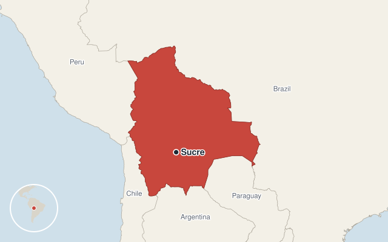
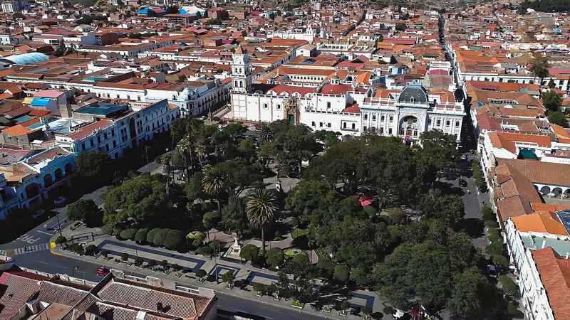

---
id    = "ba821531-2baf-570f-9a10-df73e32d8cf1"
model = "Basic"
tags  = ["south_america", "sovereign_state", "capital"]
---

## Front

What is the capital of <b>Bolivia</b>?

## Back

<b>Sucre</b>

## Extra

<i>Photo: Parallelepiped09, CC BY-SA 4.0, via Wikimedia Commons</i>

About 360,500 people (2021) 2,790 m up, the second-highest capital after Quito

Bolivia's constitutional capital and the seat of its judiciary, while the government sits in La Paz. It was the first capital of Bolivia.

While Sucre is the constitutional capital, La Paz is the seat of government.

<a href="https://en.wikipedia.org/wiki/Sucre">Sucre on Wikipedia</a> <a href="https://en.wikipedia.org/wiki/Bolivia">Bolivia on Wikipedia</a>
