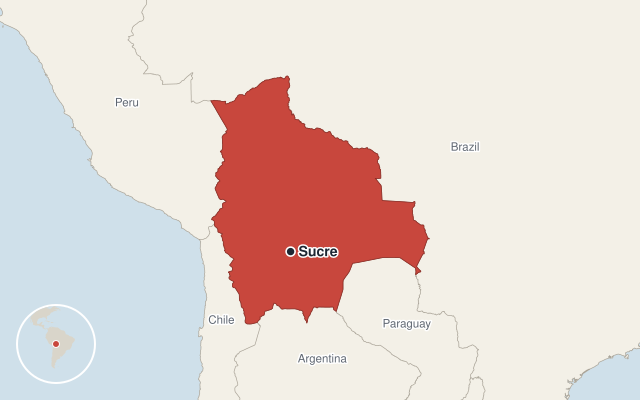

---
id    = "cd94ec38-49fc-5693-b3a1-cc947919a0bb"
model = "Basic"
tags  = ["south_america", "sovereign_state", "country"]
---

## Front

<b>Sucre</b> is the capital of which country or territory?

## Back

<b>Bolivia</b>

## Extra

While Sucre is the constitutional capital, La Paz is the seat of government.

<a href="https://en.wikipedia.org/wiki/Bolivia">Bolivia on Wikipedia</a> <a href="https://en.wikipedia.org/wiki/Sucre">Sucre on Wikipedia</a>
