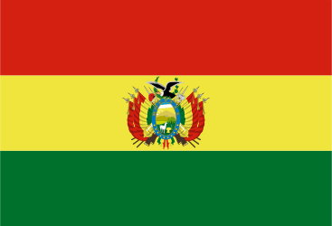
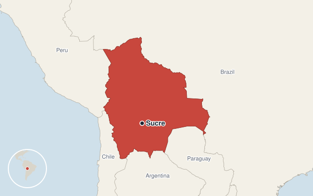

---
id    = "6e726396-e900-517b-a161-6fd21e2f168a"
model = "Basic"
tags  = ["south_america", "sovereign_state", "flag"]
---

## Front

Whose flag is this?

## Back

<b>Bolivia</b>

## Extra

Created in 1851

Red, yellow and green bands. The naval ensign for rivers and lakes carries a large star for the right to sea access, lost in the War of the Pacific in 1884.

Similar flags: Ghana (star instead of coat of arms)

<a href="https://en.wikipedia.org/wiki/Flag_of_Bolivia">Flag of Bolivia on Wikipedia</a> <a href="https://en.wikipedia.org/wiki/Bolivia">Bolivia on Wikipedia</a>
