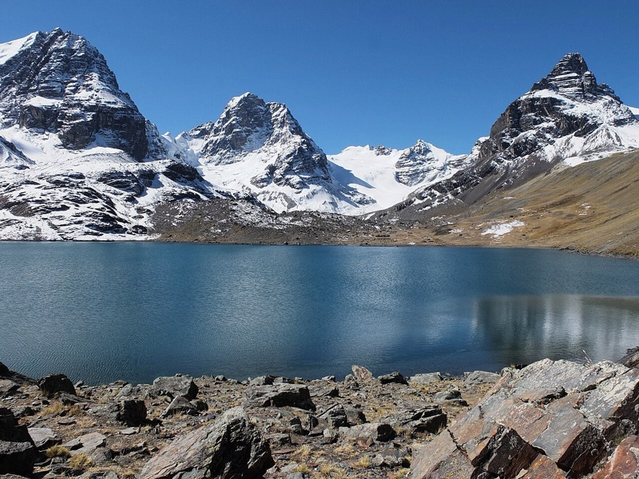

---
id    = "20d6c15c-aa2c-589a-a73c-17f6e99eebd4"
model = "Basic"
tags  = ["south_america", "sovereign_state", "map"]
---

## Front

What is highlighted on this map?

## Back

<b>Bolivia</b>

## Extra

<i>Photo: Albert Backer, CC BY-SA 3.0, via Wikimedia Commons</i>

Neighbours: Brazil, Paraguay, Argentina, Chile and Peru One-third of the country is in the Andes

Andean region in the west, with the high Altiplano plateau, and tropical lowlands in the east and north. With Paraguay it is one of two landlocked countries in the Americas.

<a href="https://en.wikipedia.org/wiki/Bolivia">Bolivia on Wikipedia</a>
