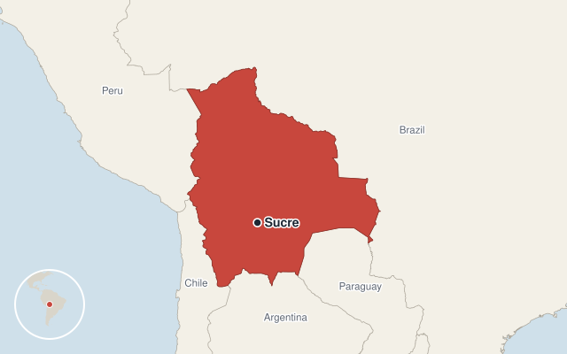

---
id    = "20d6c15c-aa2c-589a-a73c-17f6e99eebd4"
model = "Basic"
tags  = ["south_america", "sovereign_state", "map"]
---

## Front

What is highlighted on this map?

## Back

<b>Bolivia</b>

## Extra

<a href="https://en.wikipedia.org/wiki/Bolivia">Bolivia on Wikipedia</a>
